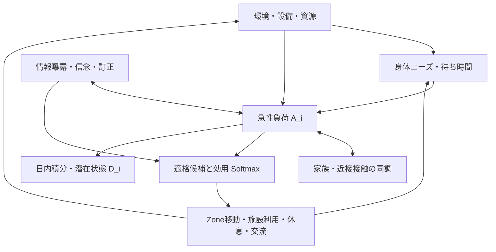

# 07. モデル統合・ODD

## 因果構造

## ODD Protocol

### Purpose

避難所運営条件と方針を、明示した合成Scenario内で比較し、資源・行列・行動・心理状態のコード上の相互作用を調べます。現実の個人行動や心理的転帰を予測しません。

### Entities and state variables

- Agent: needs, activity, acute stress/distress, optional daily latent distress, information belief, household/zone, mobility and support state.
- Facility: capacity, working units, FIFO queue, active service, outages.
- Staff: skills, shift, assignment, fatigue/support state.
- Zone and edge: adjacency, declared minutes, optional geometry/capacity/environment.
- Information claim: simulation truth, Agent exposure, belief, share propensity, correction exposure/acceptance.
- Resource ledger: stock, reservation, issue, consume, loss, release.

### Process overview and scheduling

Simulation clock is integer minutes. A tick dispatches due events atomically, updates movement and agent state, proposes due actions from an immutable view, arbitrates queues/staff/resource capacity, samples social contacts and records metrics. Contact and message transfers are generally scheduled for the next tick; they do not mutate agents during their sender loop. Psychological daily accumulator observes post-social acute state once per tick and updates (D) at minute boundaries 1439, 2879, etc.

### Design concepts

Emergence is represented only within a synthetic bounded contact network. Adaptation is represented by actions and state-dependent choices. Objectives are relative utilities/urgencies, not learned preferences. Prediction is not claimed. Sensing is limited to stored state and explicit messages. Interaction is local sampled contact or typed event. Stochasticity uses `CounterRNG` keys for order-independent reproducibility. Collectives are modeled through family/zone membership, not emergent group identity. Observation is through metrics and trace artifacts.

### Initialization and input data

Scenario profiles, capacity, routes, facilities, scheduled events, policy versions and seeds initialize the world. The repository's standard 100-agent fixture is synthetic. There is no empirical population or distress calibration dataset.

### Submodels

Submodels are listed in `01`–`06`. The formula registry validates the selected model and coefficient signature. Legacy policies remain available for controlled comparisons.

## 1 tick responsibility order

1. Dispatch due events, including completed service, delivery, rumor/correction, recovery, support and movement events.
2. Refresh routing if geometry changed and admit valid arrivals.
3. Update movement progress and construct a read-only `WorldView` snapshot.
4. Compute psychology inputs and acute update. Sample the contact graph from the same snapshot, then calculate signed social deltas without in-loop Agent mutation.
5. Accumulate the final post-social acute values into daily statistics exactly once.
6. Apply state deltas.
7. Propose choices for Agents whose scheduled decision is due; filter unavailable or ineligible actions before softmax.
8. Arbitrate facility/resource queues and staff; reservations prevent simultaneous double allocation.
9. Sample information and proximity contacts and schedule accepted proposals for a later tick.
10. Capture metrics and trace outputs.

## 二重計上を防ぐ責務

急性 `stress` の唯一の書き手は state-delta適用です。平均回帰は選択された心理policyが1回適用します。`expressiveness-channel-openness-v1` は自然回復を適用しません。legacy social modelは互換のため独自回復を持ちますが、新心理policyと組み合わせた場合に回復係数を0にします。社会支援、休息/睡眠、訂正効果は異なる明示イベント/入力として扱い、同じ回復率へ重ねません。

情報訂正は新モデルでは受容確率に成功したAgentだけを信念訂正・安心効果・query pressure reliefへ結びます。曝露だけで信念は反転しません。心理状態は情報共有確率へ、情報結果は次回の心理入力へ戻るため、イベント境界を通したfeedbackです。

行動選択はstate snapshotを使い、設備利用は次のarbitrationでcapacity/FIFOを確認します。実際のservice完了まで在庫consumeを確定しません。

## 更新時間とfeedback

| 状態 | 更新間隔 | 単位 |
|---|---:|---|
| acute (A_i), need, contact duration | 1分tick | 正規化値 / minute |
| contact-based information | 1分ごとに抽出、次tickで反映 | hazard / probability per contact |
| latent (D_i) | 1440分ごと | 日単位の潜在状態 |
| facility/resource/service | due event時 | 分、個、ml、meal unit |
| route | 移動開始時とroute変更時 | m, m/min, minute |

急性・日単位パラメータの時間単位は混在させず、移動・資源はそれぞれの物理/計数単位を維持します。

## 再現性・互換性

同seedはCounterRNGの安定キーでAgent処理順への依存を避けます。policy id・全設定値・source provenance・model signatureをrun artifactへ保存します。旧 `stress` APIは急性状態として保ち、デフォルトモデルの既存挙動を比較対象に残します。Checkpointsは心理・情報の追加runtime stateを含みます。
