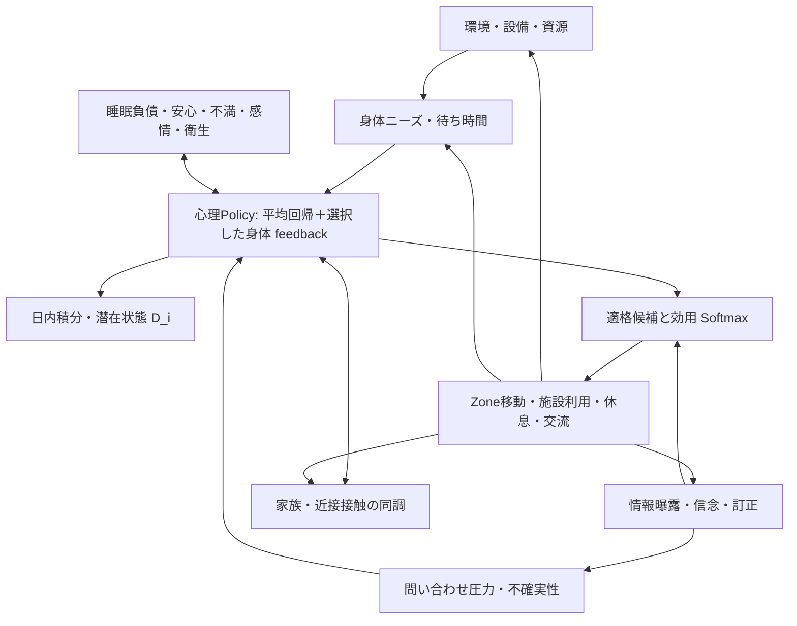

# 07. モデル統合・ODD

## 因果構造

`mean-reverting-life-state-v1` は平均回帰と既存のbody/affect状態を合成する明示的policyです。既存の `mean-reverting-distress-v1` と `life-state-feedback-v1` の意味は変更しません。false claimを信じることは不確実性へ入り、受容した訂正が信念状態を変え、訂正eventはbody stateに一度だけ反映されます。

## ODD Protocol

### Purpose

明示したScenario内で避難所運営条件、行動、待ち行列、資源、心理・社会・情報機構のコード上の相互作用を比較します。現実の個人行動、心理的転帰、医療診断は予測しません。

### Entities and state variables

- Agent: needs, activity, acute `stress`/distress、任意の日単位潜在状態、information beliefs、household/zone、mobility、body/affect、support state。
- Facility: capacity、working units、FIFO queue、active service、outages。
- Staff: skills、shift、assignment、fatigue/support state。
- Zone/edge: adjacency、宣言された移動時間、任意のgeometry/capacity/environment。
- Information claim: シミュレーション上の真偽、曝露、信念、共有、訂正曝露/受容、履歴flag。
- Resource ledger: stock、reservation、issue、consume、loss、release。

### Process overview and scheduling

時計は整数分です。due event処理、移動・状態更新、候補行動とcapacity arbitration、記録と次tickへのcontact schedulingを実行します。情報訂正はdue eventの中で受容判定とbelief/body-state変化を一度だけ適用します。一般の対面情報伝播は候補確率から次tickに反映します。急性psychologyの入力と社会同調は同じtick開始 `WorldView` から計算します。日単位状態は社会更新後のfinal acute値を各分ちょうど一度積分し、1440分境界で更新します。

### Design concepts

Emergenceは合成・疎接触network内に限ります。適応は行動選択と状態依存効用で表し、目的は学習済み選好ではありません。Agentは保存状態、明示情報、施設/身体状態を使います。乱数はstable key付き `CounterRNG` を利用します。感情同調と積極的支援は別の作用です。Traceと実行指標は内部状態の観察であり、実測妥当性を示しません。

### Initialization and input data

Scenario profiles、容量、route、施設、予定event、policy versions、seedからWorldStateを生成します。100人fixtureは合成入力です。実測の心理・関係・サービス時間校正データはありません。schema 1情報checkpointは互換読込し、情報更新時にschema 2へ移行できます。

### Submodels

詳細は `01`–`06` を参照してください。policy registryは選択IDと係数signatureを検証します。従来Policy IDと新しい統合版は明示選択により比較できます。

## 1 tickの責任・更新順序

1. due eventsを処理します。rumor/correction、サービス完了、資源配布、支援、移動等を適用し、受容された訂正のbody state変化はここで一度記録します。
2. 必要なroute/arrival更新を行い、movementを1分進めます。
3. 更新前のAgent・設備・body・information beliefを参照する `WorldView` を生成します。統合版用のfalse-claim pressureは現在信じているfalse主張から算出し、message ID、origin event、belief event、sourceを保持します。
4. 心理Policyがニーズ・queue・support・環境および選択policyに応じたbody/uncertainty inputを計算します。平均回帰policyでは自然回復と定係数外力の解析積分を一度適用し、最終stressをclipします。
5. 有効なsocial policyは同じtick開始snapshotの近隣stressを使ってsigned同調差分を計算し、心理値へ一度適用します。心理Traceに心理差分・clip差分・社会差分・実適用差分を分けて記録し、social Traceにはpair式を記録します。
6. オンライン高負荷時間monitorはpost-social心理値から軽量なepisode/recovery指標を更新します。これは心理状態を変えません。daily latent accumulatorもpost-social値を一度受け取ります。
7. 全Agentの検証済みstate deltaを適用します。
8. 適格な候補に対して行動効用/Softmaxを計算します。
9. 施設、資源、staff capacityをarbitrationし、必要なreservationとservice eventを予定します。
10. 情報・proximity contactを抽選し、適用対象がいるcontactは次tick以降に処理します。成果物へmetrics/Traceを記録します。

各更新は同じsnapshotを参照し、Agent順にstressを書き戻す処理はありません。correction eventは別にevent境界で状態を変え、その差分にevent provenanceを残します。

## 自然回復・休息・支援の重複防止

急性stressの唯一の保存先は `AgentState.stress`、適用責任は `apply_state_deltas` です。選択した心理policyだけが自然回復を持ちます。Bosse-inspired同調版に自然回復はありません。旧社会policyと平均回帰policyを組み合わせる場合もsocial側の自然回復率を0にします。

統合版は旧life-state直接sleep/rest stress recoveryを0にします。睡眠・休息は睡眠負債/疲労、安心・positive affectなどの状態を変える経路で残し、それらから心理feedbackを作ります。受容済み訂正はevent時にbody uncertainty/reassuranceを一度変えます。以後、残存する信念のpressureは持続状態として不確実性への分単位入力となり、訂正を受け入れるとfalse-belief pressureが消えます。event pulseを毎tick再生していません。社会同調はさらに別のsnapshot差分です。

## 時間単位とfeedback

| 状態 | 更新 | 単位/意味 |
|---|---:|---|
| acute `A_i`, needs, contact state | 1分tick | 正規化値、必要圧力は正規化値/分 |
| natural recovery `κ` | 1分tick解析解 | `1/minute` |
| belief pressure | 毎tickの有効信念状態 | 不確実性に入る持続的状態圧力。イベント一回適用ではない |
| long-term `D_i` | 1440分ごと | 日ごとの潜在状態 |
| distress online monitor | 1分tick | 閾値以上の分数、episode/回復回数。閾値0.70は非臨床の内部指標 |
| facility/resource/service | due event | minute、個、ml、meal unit |
| movement | 移動開始/route変更 | 宣言距離・速度・分。実距離がなければ固定移動時間 |

## 再現性・互換性

同seed・同Scenario・同モデル設定はkeyed RNGと安定した順序により再現します。Trace ON/OFFは状態更新や乱数消費を変えません。model ID、設定、seed、source provenance、signatureはrun artifactへ記録します。従来の `stress` APIと旧policy IDを保持します。情報runtime stateはv1入力を検証でき、更新時のv2移行を用意します。
