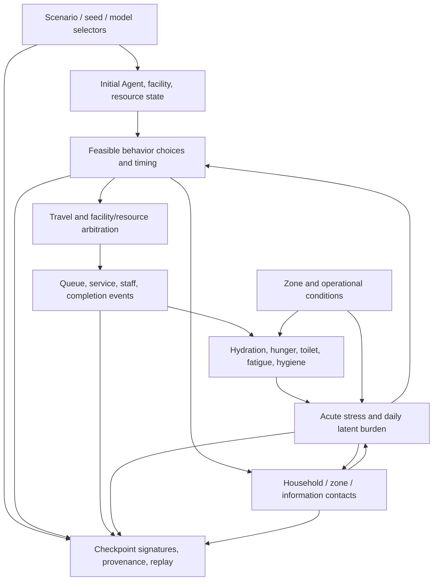

# 11. 中核モデル監査

## 対象と判定方法

この監査はコード上の式、単位、更新順、Policy Registry、Trace、既存テストを突き合わせた内部監査である。文献はモデル構造の根拠として扱い、ShelterSimの係数・避難所での予測精度を証明するものとは扱わない。各項目の「適用」は保存済みScenarioの選択に従う。新規Scenarioの候補セットは [14-default-model-suite.md](14-default-model-suite.md) に記録した。

| 領域 | 実装・選択Policy | 状態式・単位・時間尺度 | 接続、根拠、仮定 | 主なテスト・問題 | 優先度 |
|---|---|---|---|---|---|
| 急性心理ストレス・自然回復 | `policies/psychology.py`; `mean-reverting-life-state-v1` または明示された旧Policy | 1分tick。一定外力時は指数平均回帰の解析解で更新。stressは正規化0..1、回復率は1/min | unmet need、queue、staff、body、環境、情報から外力を受ける。自然回復と負荷係数は未校正 | 解析解・刻み一致・無刺激回復・持続外力のテストあり。clip前後差と飽和をTraceに記録。持続外力の固定点は全状態を含めて未証明 | P0 |
| 日単位の累積心理負荷 | `domain/psychological_state.py`, `simulator_state.py`; state schema付き | acute stressの履歴から1440分境界で更新する潜在状態。日単位・正規化 | acute stateと区別しRun/Checkpointに保存。集計係数は仮定 | 日境界、post-social一度積分、復元テストあり。実測対応なし | P1 |
| 睡眠・睡眠負債・疲労 | `policies/psychology.py`, `domain/body_state.py`, `policies/behavior.py`; body formula v1/v2 | sleep debtは分、0..1440。覚醒/睡眠/休息で毎分更新。fatigueは正規化状態 | sleep choice、zone rest efficiency、stress feedbackに接続。二過程睡眠モデルは構造の参考。分単位係数は仮定 | 初期fixtureに必要睡眠時間がなく、旧rate 1.0/minで16時間覚醒・8時間睡眠の収支が不均衡。v2は必要時間Sに対し覚醒rate S/(1440-S)、未指定時0.5、休息回復0とする。個人別睡眠リズム・睡眠効率は未校正 | P0 |
| 空腹・水分不足・排泄欲求 | `policies/psychology.py`, `events/handlers.py`, `policies/behavior.py` | 正規化need 0..1、増加/min、サービスevent完了時に設定量を減算 | action choice、resource ledger、facility queueへ接続。需要率・ml/mealへの変換は仮定 | service完了後にneedが減ることをTraceで確認。250mlとneed 0.35等は物理量に校正されず、現状の「十分な供給」は需要との物理的比較にならない | P0 |
| 衛生・sanitation・不満・安心・affect | `domain/body_state.py`, `policies/affect.py`, psychology policy | normalized 0..1を毎tick更新。stressは分単位外力、reassurance/positive affectは減衰・回復状態 | staff care、privacy、sanitation、sleep、stress feedbackに接続。係数はsynthetic assumption | body formula Trace、care lifecycleテストあり。式の状態間経路は実装されるが係数と長期平衡は未校正。negative affectとstressの名称上の経路は追加確認対象 | P1 |
| 行動適格性・効用・選択時刻 | `policies/behavior.py`; historical `utility-softmax-v1`, default candidate `sleep-aware-utility-softmax-v2` | 適格候補の効用を温度付きsoftmaxで確率化。suite v2は睡眠負債Dを日必要睡眠S_i（未指定時480分）で割った項をsleep utilityへ加算。判断間隔15分 | need urgency、sleep/meal rhythm、facility awareness、capacityへ接続。ランダム効用の理論は選択構造のみを支持。v2のweight=1は未校正仮定 | feasible-set、softmax境界、v1/v2候補効用、決定的乱数テストあり。v2の7日Runで睡眠負債平均は981.3分へ改善したが、長期stress平均0.9019、高stress率94%は未解決 | P0 |
| 行動継続・中断・再試行 | `domain/action_lifecycle.py`, `events/handlers.py`, `policies/behavior.py` | 分単位のaction lifecycleとdeadline/retry event | service、移動、queue、resource予約に接続 | lifecycle・cancel・timeout・再試行テストあり。設備不能/選択肢なしの長期適応はScenario別確認が必要 | P1 |
| 施設認知・施設利用 | `domain/agent_dynamics.py`, `policies/behavior.py` | known facility IDsの状態遷移; 到着・案内eventで更新 | facility、移動、choiceに接続。案内の有無はScenario設定 | 初期案内と学習テストあり。実際の案内率は未観測。新規生成Scenarioは共有サービスの入口案内を仮定 | P1 |
| 待ち行列・サービス | `domain/facility_queues.py`, `policies/queueing.py`; need-weighted physical queueまたはstrict FIFO | task arrival/service start/completionは整数分、capacity/working units、待ち時間は分 | need severity、facility、staff、移動、service後needに接続 | FIFO/capacity/timeout/abandonmentテストあり。旧心理式はqueued毎分0.002を加算。長待機は供給・処理能力と離脱条件に依存し、短縮自体を成功条件にしない | P0 |
| 資源在庫・予約・消費 | `domain/resources.py`, `events/handlers.py` | ml、meal unit、item countなどの物理量でreserve/consume/release | resource serviceからneed reliefへ接続 | 保存則・重複予約・失敗eventテストあり。need量との変換係数は別途校正が必要 | P0 |
| Staff対応・疲労 | `domain/staff_operations.py`, `domain/staff_dynamics.py`, staff Policy factory | 作業時間、shift、skill、fatigue、割当eventは分単位 | 支援、待機、care outcome、施設容量に接続 | staff routing、fatigue、support lifecycleテストあり。effect size/処理時間と実績サービス統計の対応なし | P1 |
| 感情伝播と社会的支援 | `policies/social.py`, `domain/social_network.py`, `policies/proximity.py` | 同調は接触相手との差 stressに expressiveness×channel×openness rateを掛け、bounded signed deltaとして1分tick適用。支援は別event | 家族/zone/近接contactとrelationship、stressへ接続。Bosseは構造参考のみ | 正負両方向、同値ゼロ、無接触ゼロ、上限、Traceテストあり。物理近接は座標があるScenarioだけ。係数・接触頻度は未校正 | P1 |
| 情報・噂・訂正 | `policies/information.py`, `domain/information.py`, `events/handlers.py` | message exposure, belief strength/status, sharing propensity, correction acceptance, uncertainty/reassurance stateを分離。分単位更新 | network contactから信念、心理状態、行動に接続 | belief/correction/false-claim pressure/replayテストあり。訂正による安心は自動で保証しない。接触や主張がなければ寄与ゼロ | P1 |
| 移動・混雑 | `domain/movement.py`, `policies/movement.py`, geometry/route adapters | 路線距離・速度はm/min、移動時間は整数分。capacity/route closureはイベント | 行動先、facility queue、位置接触に接続 | route/reachability/closureテストあり。実形状がないScenarioへ実建物形状を推測しない。局所混雑が心理式に入る条件は限定的 | P1 |
| 人口・初期状態・個人差 | `region/population.py`, `contracts/population.py`, `experiments/initial_scenario.py` | Profileのneed/stress sensitivity、household、age band、mobility等 | need、choice、support、contactへ接続 | seed再現・schema・household testsあり。合成分布を実避難者分布と誤認しない。相関や必要睡眠の多くは未入力 | P1 |
| 環境・温度・照明・騒音・privacy | `domain/environment.py`, `policies/registry.py` | 温度°C、他は0..1、zone別基準とイベント差分 | rest efficiency、hygiene、discontent、stressへ接続 | unit bounds・formula factory testsあり。Scenarioにない環境状態を推測せず、各効果は未校正 | P2 |
| 更新順・決定的乱数 | `core/tick.py`, `core/engine.py`, `core/rng.py` | 整数分、安定したpriority/sequence、keyed random streams | 全Policy/eventの時間契約 | order、same seed、Trace ON/OFF、replayテストあり。外部Providerはcoreから分離され、recorded responseのみ入力 | P0 |
| 長期安定性・clip | 心理/body/need/queue各状態、`inspection/traces.py` | bounded stateと累積イベントを明示。clip deltaは心理traceへ記録 | state feedback loop、capacity、行動選択 | 1日基準で73%が0.7以上、p95=1.0。v2 7日では94%が0.7以上、最長high-stress episodeは9,872分。飽和は実測上の真値ではなく入力・clipの観測限界を示す。統合系の固定点/感度は未完了 | P0 |
| Checkpoint・Branch・モデル版 | `core/checkpoint.py`, `contracts/policies.py`, `storage/projects.py` | model/version/config signatureを保存し復元時に照合 | Run成果物・branch分離・再現性 | 既存Checkpoint契約テストあり。suite IDを独立signatureに含め、旧selectorはそのまま保存する | P0 |

## 主な依存関係

## 優先して扱う問題

1. **P0 — 閉ループの入力過多と飽和**: 心理の回復式は正常でも、need・queue・body feedbackが回復を上回る。原因Traceを用いて平衡を説明し、正常条件/不足条件を分離する。
2. **P0 — 睡眠負債の収支**: 個別必要睡眠がない時に1分覚醒で1分負債が増える旧設定は、短時間のsleep actionでは埋まらない。新規候補では収支を明記する。
3. **P0 — 行動判断間隔と睡眠需要の競合**: 60分周期と正規化値から実サービス需要を推定できず、suite v1では睡眠負債が高くても他候補に負けて7日でほぼ上限へ達した。suite v2は日必要睡眠量で負債を正規化する効用仮説を追加した。7日1 seedでは睡眠負債とstress平均を改善したものの、94%が高stressのままであり、原因は残る。
4. **P1 — 標準モデルsetの入口一貫性**: 新規生成/CLI/Project/API/demoが同じ版を記録し、古いScenarioは保持する。
5. **P1 — 統合ゲート不足**: 複数seed、接続経路、各運営条件のTrace比較が不足。現時点で実地妥当性や全ゲート合格を主張しない。

変更前の心理原因分析と1日基準は [10-chronic-high-distress-investigation.md](10-chronic-high-distress-investigation.md)、モデル個別の式は [01–09](README.md) を参照。
